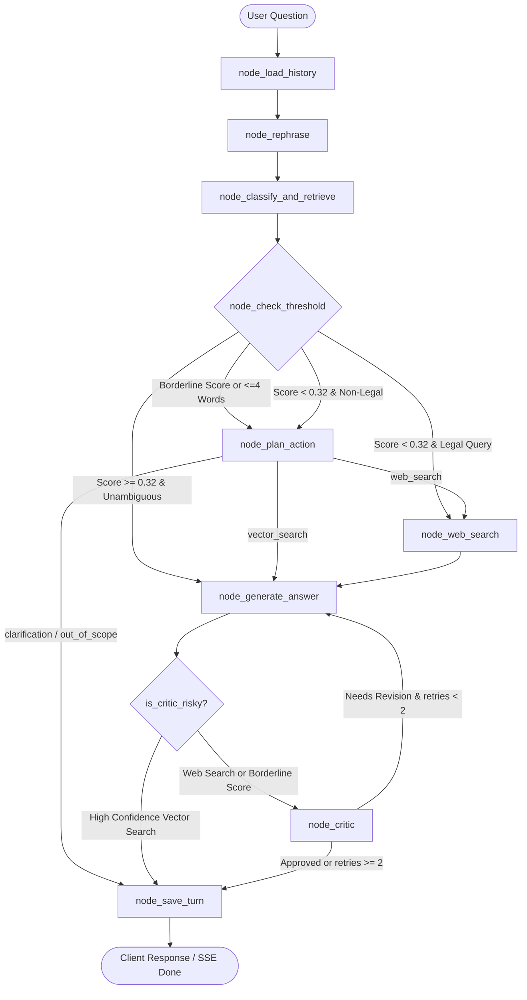

# ⚖️ Legal Advisor AI

[](https://github.com/vanshikarana06/LAC/actions/workflows/ci.yml)

An agentic RAG (Retrieval-Augmented Generation) application providing guidance on Indian statutory law across 19 Central Acts (including labour, maternity benefits, POSH, consumer protection, and criminal law).

**🌐 Live Demo:** [https://lac-oebg.onrender.com/](https://lac-oebg.onrender.com/)  
*(Note: Render free-tier services spin down during inactivity; cold start takes approximately 50–70 seconds).*

---

## 🏗️ Architecture

A 9-node stateful graph pipeline orchestrated via **LangGraph**, featuring deterministic intent routing, heuristic ambiguity detection, an agentic LLM planner, and a self-correction critic gate.



### Routing Rules

| Target Node | Condition | Source Label |
|---|---|---|
| `node_generate_answer` | Similarity score $\ge$ `SIMILARITY_THRESHOLD` (0.32) and question length > 4 words | `vector_search` |
| `node_plan_action` | Score in ambiguous range `[0.27, 0.42]`, question $\le 4$ words, or low score non-legal | `needs_planning` |
| `node_web_search` | Score < 0.32 and `is_legal_question() == True` | `web_search` |
| Refusal / Clarification | Determined by `node_plan_action` (e.g. non-legal or incomplete queries) | `out_of_scope` / `clarification` |

*The similarity threshold constant is defined in `src/api/main.py` (`SIMILARITY_THRESHOLD = 0.32`).*

---

## 🤖 Agentic Pipeline Capabilities

1. **Heuristic & Agentic Planning (`node_plan_action`)**:
   - Clear queries route deterministically with zero LLM overhead.
   - Ambiguous queries (borderline scores, short queries like "what is bnss?", or unindexed legal subjects) invoke the planner LLM to choose between web search, user clarification, or out-of-scope refusal.
2. **Targeted Critic Gate (`node_critic`)**:
   - High-confidence vector retrievals ($\ge 0.42$) bypass the critic to preserve latency.
   - Web search fallbacks and borderline vector matches are routed to the critic to verify statutory citations and prevent ungrounded claims.
3. **Self-Correction Retry Cycle**:
   - When the critic identifies inaccurate claims, it triggers revision (up to 2 retries) passing structured feedback back to `node_generate_answer`. *(Known limitation: retries re-evaluate the existing context without re-querying the database).*

---

## 📊 Evaluation & Chunking Ablation

Retrieval and generation quality was evaluated using [RAGAS](https://github.com/explodinggradients/ragas) on an $N=5$ answerable question pilot comparing the **Structure-Aware Splitter** against the **Standard Fixed Splitter**.

### Answerable Questions Metrics ($N=5$)

Source data: `docs/eval/ragas_newsplit.csv` and `docs/eval/ragas_oldsplit.csv`.

| Metric | Old Splitter (Fixed 1500/200) | New Splitter (Structure-Aware) | Delta ($\Delta$) |
|---|:---:|:---:|:---:|
| **Context Precision** | 0.0000 *(4 NaNs)* | **0.7500** *(1 NaN)* | **+0.7500** |
| **Context Recall** | 0.0000 *(4 NaNs)* | **0.6250** *(1 NaN)* | **+0.6250** |
| **Answer Relevancy** | 0.4157 *(2 NaNs)* | **0.6852** *(0 NaNs)* | **+0.2695** |
| **Faithfulness** | 0.9286 *(3 NaNs)* | **0.8556** *(2 NaNs)* | **-0.0730** |

### Evaluation Methodology & Disclosures
- **Dataset Size**: Pilot test of 7 total questions (5 answerable, 2 out-of-scope/unanswerable).
- **NaN Counts Across Full Dataset ($N=7$)**:
  - `ragas_newsplit.csv`: 5 NaNs out of 28 cells (Faithfulness: 2, Relevancy: 1, Precision: 1, Recall: 1).
  - `ragas_oldsplit.csv`: 20 NaNs out of 28 cells (Faithfulness: 4, Relevancy: 4, Precision: 6, Recall: 6).
- **Judge Model**: `openai/gpt-oss-20b` via Groq Cloud (Judge model = Generation model; introducing self-evaluation bias).
- **Ground Truth Verification**: Ground-truth statutory answers were verified against retrieved context in `docs/eval/ground_truth_check.txt`.
- **Chunk Counts**: Structure-Aware DB = 3,901 chunks; Standard Fixed DB = 3,828 chunks.

---

## 📚 Knowledge Base

**19 Indian Central Acts** (3,901 chunks indexed from `data_raw/`):
- **Constitutional**: Constitution of India
- **Labour & Employment**: Minimum Wages Act, Industrial Disputes Act, Factories Act, Contract Labour Act, Employees' Provident Funds Act, Equal Remuneration Act, Workmen's Compensation Act, Payment of Gratuity Act
- **Women's Rights**: Maternity Benefit Act, Sexual Harassment of Women at Workplace Act (POSH), Protection of Women from Domestic Violence Act
- **Criminal**: Indian Penal Code (IPC), Code of Criminal Procedure (CrPC)
- **Consumer & Civil**: Consumer Protection Act 2019, RTI Act 2005, Transfer of Property Act, Indian Succession Act
- **Family**: Hindu Marriage Act

---

## 🛠️ Tech Stack

| Component | Technology | Description |
|---|---|---|
| Backend | FastAPI (Python 3.12) | REST endpoints and Server-Sent Events (SSE) streaming |
| Orchestration | LangGraph | 9-node stateful workflow with self-correction cycle |
| LLM Inference | Groq Cloud | `openai/gpt-oss-20b` (configurable via `GROQ_MODEL`) |
| Embeddings | FastEmbed | `sentence-transformers/all-MiniLM-L6-v2` via ONNX Runtime (no PyTorch) |
| Vector Store | ChromaDB | Persistent local collection (`search_type="mmr"`, `k=6`, `fetch_k=15`) |
| Web Fallback | Tavily Search | Targeted domain search for unindexed or recent legal matters |
| Session Store | SQLite | WAL mode (`PRAGMA journal_mode=WAL; PRAGMA busy_timeout=5000`) |
| Frontend | Vanilla JS / CSS | DOM-safe entity escaping, no frontend build tools |
| Container | Docker | Non-root `appuser`, baked-in DB and model cache |

---

## 🚀 Quickstart

### Prerequisites
- Python 3.12+ (or Docker)
- API Keys: [Groq Console](https://console.groq.com) and [Tavily](https://tavily.com)

### Option A: Local Virtual Environment

```bash
git clone https://github.com/vanshikarana06/LAC.git
cd LAC

python -m venv venv
# Windows:
.\venv\Scripts\activate
# Linux/macOS:
# source venv/bin/activate

pip install -r requirements.txt
cp .env.example .env
# Edit .env with your GROQ_API_KEY and TAVILY_API_KEY

# Run server
python -m uvicorn src.api.main:app --reload --port 8001
```

Visit: `http://localhost:8001`

### Option B: Local Docker Container

```bash
# Build image (vector DB and FastEmbed ONNX models are baked in at build time)
docker build -t lac:local .

# Run container bounded to 512MB RAM (matching Render free tier)
docker run -d -p 8001:8001 --env-file .env --memory=512m --name lac_app lac:local
```

---

## ⚙️ Environment Variables

| Variable | Required | Default | Purpose |
|---|:---:|---|---|
| `GROQ_API_KEY` | **Yes** | — | Groq Cloud API authentication key |
| `TAVILY_API_KEY` | **Yes** | — | Tavily API key for web search fallback |
| `GROQ_MODEL` | No | `openai/gpt-oss-20b` | Chat model ID on Groq |
| `ALLOWED_ORIGINS` | No | `http://localhost:8001,http://127.0.0.1:8001` | Comma-separated CORS allowed origins |
| `EMBEDDING_BACKEND` | No | `fastembed` | Embedding backend (`fastembed` default, `local-torch` dev only) |
| `DB_PATH` | No | `data_vector_db` | ChromaDB vector store directory |
| `SESSION_DB_PATH` | No | `session_store.db` | SQLite conversation history database |
| `LOG_LEVEL` | No | `INFO` | Logging level (`DEBUG`, `INFO`, `WARNING`, `ERROR`) |
| `LANGCHAIN_TRACING_V2` | No | `false` | Enable LangSmith tracing |
| `LANGCHAIN_API_KEY` | No | — | LangSmith authentication key |
| `LANGCHAIN_PROJECT` | No | `legal-advisor-ai` | LangSmith project name |

---

## 🔌 API Endpoints

| Method | Path | Description |
|---|---|---|
| `GET` | `/` | Serves web chat user interface |
| `POST` | `/ask` | Synchronous legal question submission |
| `GET` | `/ask/stream` | Server-Sent Events (SSE) token and metadata streaming |
| `GET` | `/sessions` | Lists recent user chat sessions with previews |
| `GET` | `/session/{id}/history` | Retrieves full conversation history for a given session |
| `DELETE` | `/session/{id}` | Deletes session history from database |
| `GET` | `/health` | Healthcheck returning DB status, chunk count, and model ID |
| `GET` | `/acts` | Returns list of all indexed Central Acts |
| `GET` | `/docs` | OpenAPI / Swagger interactive documentation |

---

## 🧪 Testing & Verification

Run the full offline test suite (46 unit and integration tests):

```powershell
python -m unittest discover -s test -p "test_*.py"
```

Run the automated pre-push safety verification script:

```powershell
powershell -ExecutionPolicy Bypass -File scripts/prepush_check.ps1
```

---

## 📁 Project Structure

```
├── .github/workflows/ci.yml       # GitHub Actions CI workflow
├── data_raw/                      # 19 Indian Acts (source PDF statutes)
├── docs/
│   ├── ARCHITECTURE.md            # Detailed 9-node graph design & state schema
│   ├── DEPLOYMENT.md              # Render container deployment & memory budgets
│   ├── SECURITY.md                # Threat model & prompt injection defense
│   ├── KNOWN_LIMITATIONS.md       # Corpus scope, gazette ceilings & pilot caveats
│   ├── PREPUSH.md                 # Pre-push verification checklist & commit groups
│   └── eval/                      # RAGAS evaluation CSVs, sidecars & audit notes
├── scripts/
│   ├── eval/                      # threshold_check.py, injection_smoke.py
│   ├── debugging/                 # Historical exploratory scripts (unmaintained)
│   └── prepush_check.ps1          # Pre-push validation script
├── src/
│   ├── api/main.py                # FastAPI server, LangGraph workflow, SQLite store
│   ├── embeddings.py              # FastEmbedEmbeddings ONNX wrapper
│   └── ingestion/embedder.py      # PDF ingestion & ChromaDB indexing pipeline
├── static/index.html              # Frontend web UI (DOM-safe entity escaping)
├── test/                          # Unit and integration test suites (46 tests)
├── Dockerfile                     # Multi-stage container build (non-root)
├── requirements.txt               # Host development dependencies
├── requirements-docker.txt        # Container production dependencies (zero torch)
└── CHANGELOG.md                   # Chronological feature & maintenance changelog
```

---

## 📖 Extended Documentation

- [System Architecture](file:///docs/ARCHITECTURE.md)
- [Production Deployment](file:///docs/DEPLOYMENT.md)
- [Security & Threat Model](file:///docs/SECURITY.md)
- [Known Limitations](file:///docs/KNOWN_LIMITATIONS.md)
- [Pre-Push Checklist](file:///docs/PREPUSH.md)
- [Changelog](file:///CHANGELOG.md)

---

## ⚠️ Legal Disclaimer

*Legal Advisor AI provides general legal information for informational and educational purposes only. It does not constitute formal legal advice and does not create an attorney-client relationship. Users should consult a qualified legal professional for case-specific counsel.*
