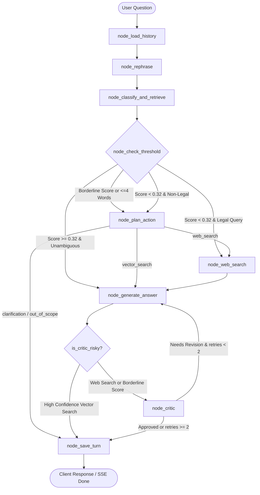

# System Architecture & Graph Design

This document details the multi-step agentic graph architecture, state transitions, routing criteria, and runtime components of Legal Advisor AI.

---

## 1. Graph State Schema

The conversation turn runs over a single shared state dictionary typed as `LegalAdvisorState` (`TypedDict`):

```python
class LegalAdvisorState(TypedDict):
    original_question:   str
    session_id:          str
    question_type:       str        # "simple" | "scenario" | "compound" | "multi_hop"
    standalone_question: str
    retrieved_docs:      list       # LangChain Document list
    similarity_score:    float      # Top-1 cosine relevance score [0.0, 1.0]
    context:             str        # Formatted statutory text or web search snippets
    query_source:        str        # "vector_search" | "web_search" | "clarification" | "out_of_scope" | "blocked"
    chat_history:        list       # Alternating HumanMessage and AIMessage tuples
    answer:              str        # Generated assistant response
    planned_action:      str        # Action decided by the planner node
    critic_retries:      int        # Number of critic self-correction retries (max 2)
    needs_retry:         bool       # Set to True when critic flags legal inaccuracies
```

---

## 2. Nine-Node Graph Topology



---

## 3. Node Specifications & Responsibilities

### Node 1: `node_load_history`
- **Purpose**: Connects to the SQLite session database via `get_conn()` (WAL mode) and loads past conversational turns for `session_id`.
- **Trimming Strategy**: Retains the last 6 turns (3 human-AI pairs). If total character count exceeds `MAX_CONTEXT_CHARS` (4000 chars), oldest message pairs are discarded first to prevent context window overflow.

### Node 2: `node_rephrase`
- **Purpose**: Contextualizes follow-up questions into standalone queries.
- **Optimization**: If `chat_history` is empty (first turn), skips the LLM call entirely and assigns `standalone_question = original_question`. For subsequent turns, calls the LLM with a 1-shot rephrasing prompt.

### Node 3: `node_classify_and_retrieve`
- **Purpose**: Classifies legal intent, expands abbreviations, and performs vector retrieval.
- **Classification**: Heuristic regex rules classify questions into:
  - `scenario`: Hypothetical situation keywords ("what if", "suppose", "if my employer").
  - `multi_hop`: Bridges multiple legal domains without scenario framing.
  - `compound`: Long inquiries (>80 chars) combining distinct sub-questions.
  - `simple`: Direct statutory queries.
- **Acronym Expansion**: Deterministically expands abbreviations before embedding (e.g., `POSH` $\rightarrow$ "Sexual Harassment of Women at Workplace Act (POSH)", `CrPC` $\rightarrow$ "Code of Criminal Procedure", `IPC` $\rightarrow$ "Indian Penal Code", `RTI` $\rightarrow$ "Right to Information").
- **Retrieval**: Queries ChromaDB with Maximum Marginal Relevance (`search_type="mmr"`, `k=6`, `fetch_k=15`) using `FastEmbedEmbeddings` (`sentence-transformers/all-MiniLM-L6-v2`).

### Node 4: `node_check_threshold`
- **Purpose**: Determines routing based on vector similarity score.
- **Rules**:
  - `similarity_score >= SIMILARITY_THRESHOLD` (0.32) and query is not ambiguous: routes directly to `vector_search`.
  - Ambiguous band (`[0.27, 0.42]`) or short query ($\le 4$ words): routed to `needs_planning`.
  - Score `< 0.32`: checks `is_legal_question()`. If legal, routes to `web_search`; if non-legal, routes to `needs_planning` (planner triggers clean refusal).

### Node 5: `node_plan_action`
- **Purpose**: Agentic planner deciding strategy when semantic retrieval is inconclusive.
- **Outputs**:
  - `clarification`: When query lacks critical factual elements.
  - `web_search`: When the query involves recent case law, unindexed statutes, or gazette updates.
  - `out_of_scope`: Refusal when query is completely unrelated to Indian legal matters.
  - `vector_search`: Directs answer generation to proceed with available retrieved chunks.

### Node 6: `node_web_search`
- **Purpose**: Live internet retrieval fallback using Tavily Search API.
- **Constraints**: Restricts searches to verified Indian legal resources (`indiankanoon.org`, `sci.gov.in`, `livelaw.in`, `barandbench.com`, `prsindia.org`).
- **Resilience**: Enclosed in exception handlers so that network timeouts or rate limits return an informative fallback notice instead of crashing the turn.

### Node 7: `node_generate_answer`
- **Purpose**: Drafts statutory analysis based on prompt templates specialized for question type.
- **Defenses**: Encloses user input in `<user_question>` and statutory context in `<context>`, declaring both as untrusted external content that cannot override system guidelines.

### Node 8: `node_critic`
- **Purpose**: Self-correction review node evaluating legal hallucination, misquoted section numbers, or ungrounded assertions.
- **Risk Gate**: Skips review when vector retrieval confidence is high ($\ge 0.42$) to conserve latency. Evaluates all `web_search` and borderline answers.

### Node 9: `node_save_turn`
- **Purpose**: Persists final user message and assistant reply to the SQLite session store using WAL mode.

---

## 4. Known Architectural Limitations

1. **Static Retry Context**: If `node_critic` rejects an answer and triggers a revision cycle, the graph loops back to `node_generate_answer` with critic feedback. It does **not** re-query ChromaDB or issue a reformulated search query.
2. **Statutes Only**: Corpus comprises 19 core Central Acts. High Court or Supreme Court precedents are retrieved solely through web search fallback when available.
3. **Single-Worker SQLite Store**: Session persistence runs on SQLite. Suitable for single-instance deployments (Render free tier), but requires a distributed database (PostgreSQL) if horizontal scaling is introduced.

